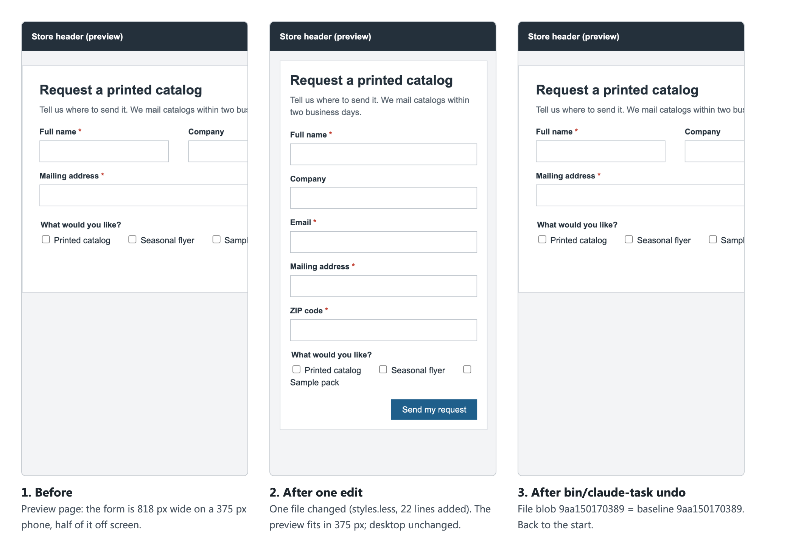

# Walkthrough: explain, plan, change one file, undo

One real Claude Code session (2.1.296, model `claude-sonnet-5-5`, manual mode,
on a subscription), four prompts, run by `sessions/run_sessions.py` on a
throwaway copy of the synthetic fixture. Raw records:
[`evidence/sessions/s01_walkthrough/`](../evidence/sessions/s01_walkthrough/)
(readable version: [transcript.md](../evidence/sessions/s01_walkthrough/transcript.md)).



The screenshots are of a **preview page**: `tools/render_preview.py` turns the
fixture's Smarty template and LESS file into static HTML, because the lab has
no CS-Cart install. The widths were measured on that page in a headless browser.

## 1. "Explain this first ... Do not change anything."

Claude listed the add-on's five files in a table, the names that tie them
together (form name, ZIP field id, `dispatch=catalog_request.send`), and what
it could not confirm from the folder (where `lab_queue_mail` is defined, how
the block is placed on a page). It concluded that nothing outside the add-on
uses its own `ty-catalog-request*` classes.

What it did **not** say: the form's fields also use the shared classes
`ty-control-group` and `ty-input-text`, defined in `css/tygh/forms.less`,
which the checkout template uses too. An earlier run had pointed this out,
but at that time the fixture carried a comment naming the dependency; the
comment was removed and the session re-run, and this run missed it. That is
why the owner guide has the human check the file list at step 2, and why the
task tool, not the model, decides which files may be edited.

One search command was refused by the guard on the way, because its text
mentioned `.claude/`; Claude switched to other commands.

## 2. "Show the intended files ... Do not edit yet."

> **One file:** `design/themes/custom_theme/css/addons/catalog_request/styles.less`
>
> No template, script or PHP changes are needed.

followed by the exact block it proposed to add.

## 3. The human opens the task, then: "Go ahead: make only this change, in that one file."

```
$ bin/claude-task start catalog-form-mobile design/themes/custom_theme/css/addons/catalog_request/styles.less
Task 'catalog-form-mobile' open on branch claude/catalog-form-mobile.
Baseline: commit 2aa46049c154
  may edit: design/themes/custom_theme/css/addons/catalog_request/styles.less (baseline blob 9aa150170389)
```

In this recorded run the edit was **pre-approved on the command line**
(`--allowedTools "Edit(design/.../styles.less)"`) in place of a human
answering yes to the permission question; in the owner's interactive session
that question is asked. Claude made one Edit call; the guard logged it as
`edit inside task 'catalog-form-mobile'`. `bin/claude-task diff` shows the
change, with no WARNING line (nothing else in the folder moved):
[task.diff](../evidence/sessions/s01_walkthrough/task.diff), one
`@media (max-width: 480px)` block, 22 lines added, nothing removed.

On the preview page ([widths.txt](walkthrough/widths.txt)): 818 px wide on a
375 px phone before, 375 px after; desktop rendering unchanged.

## 4. "Show me how to undo it."

> ```
> bin/claude-task undo
> ```
> It's meant to be run by a person, not by me, so I won't run it.

The human runs it:

```
$ bin/claude-task undo
OK   design/themes/custom_theme/css/addons/catalog_request/styles.less: now 9aa150170389, baseline 9aa150170389
Task 'catalog-form-mobile' undone. Back on main at baseline 2aa46049c154.
```

The proof of the restore is the file's git blob hash compared with the one
recorded at `start`, not a message. The preview page is back to 818 px.
